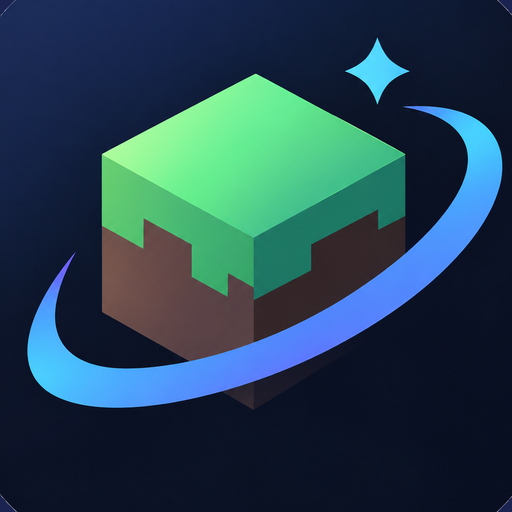

<p align="center">
  
</p>

# ZyNova

> **Minecraft: Java Edition · Android Launcher**
>
> ZalithLauncher2 오픈소스 코드를 기반으로 개발된 독립 비공식 프로젝트

[](https://developer.android.com/)
[](https://kotlinlang.org/)
[](https://www.gnu.org/licenses/gpl-3.0.html)
[](https://github.com/zzy89216-gif/ZyNova/releases/tag/v27.6.1)

[简体中文](README.md) | [English](README_EN.md) | [繁體中文](README_ZH_TW.md) | [日本語](README_JA_JP.md) | **[한국어](README_KO.md)** | [Русский](README_RU.md)

---

## ✦ 소개

**ZyNova**는 [ZalithLauncher2](https://github.com/ZalithLauncher/ZalithLauncher2)의 오픈소스 코드를
기반으로 개발된 **비공식** Minecraft: Java Edition Android 런처입니다.

> **ZyNova는 ZalithLauncher2의 공식 버전이 아닙니다.**
>
> 독립적으로 유지보수되고 배포되는 비공식 수정 프로젝트입니다.

- GitHub: <https://github.com/zzy89216-gif/ZyNova>
- Issues: <https://github.com/zzy89216-gif/ZyNova/issues>
- Discord: <https://discord.gg/QwPpZQHrTa> (영구 초대)

---

## ✨ 27.6.1 하이라이트

- **상단 5개 버튼 복원.** 폴더 / AI / 멀티플레이 / 다운로드 / 설정 버튼이 27.6.0 이전 모습으로
  돌아갔으며, 더 이상 홈 버튼 재질을 적용하지 않습니다.
- **고스트 버튼.** 실행 / 월드 생성 / 서버 추가 / 월드·서버 항목은 배경과 약 1.5~2%의 명암 차이만
  두고, 테두리 없이 투명도를 유지해 이미지·영상 배경이 실시간으로 비칩니다. 월드 생성과 서버 추가
  버튼은 작게 줄여 실행 버튼 옆에 배치했습니다.
- **버전별 월드 생성.** 26.1 이상은 실제 분리 저장 형식(`difficulty_settings`,
  `world_gen_settings.dat`, `game_rules.dat`)을 직접 기록하고, 1.12.2~26.0은 DataFixer 경로를
  사용합니다. 1.12.2 미만에서는 항목을 숨기며, 생성 후 다시 읽어 검증합니다.
- **치트 허용.** 월드 생성 시 «치트 허용» 스위치를 제공하며, Minecraft 1.4 이전에서는 숨기고
  꺼진 상태로 기록합니다.
- **Fabric API 로딩 상태.** Fabric API 목록이 로딩 중일 때는 «로딩 중»만 표시하고 설치를 잠시
  비활성화합니다. 로딩 성공 후에만 설치할 수 있고, 실패하거나 목록이 비어 있을 때만 거부합니다.
- **27.6.0 기능 유지.** Fabric API 보호, 아이콘 수정, 홈 버튼 재질, 원클릭 월드/서버 생성이
  그대로 유지됩니다.

> 이전 버전의 전체 변경 내역은 [CHANGELOG.md](CHANGELOG.md)를 참고하세요.

## 🛠️ 주요 기능

### AI Agent

ZyNova에는 로그 확인, 모드 관리, 설정 편집, 리소스 설치, 게임 실행을 실제로 수행할 수 있는
내장 AI Agent가 있습니다. 기본 제공자는 DeepSeek이며, OpenAI 호환 API도 사용할 수 있습니다.
모델 목록은 공급자에게서 동적으로 가져오고, API Key와 Base URL은 별도로 저장됩니다.

### 렌더러

- **자동**: Minecraft 버전과 호환되는 렌더러를 자동 선택
- **MobileGlues**
- **Ironized Zink**
- **GL4ES**

### 카드형 홈

설치된 인스턴스를 카드로 보여 주고, 각 카드에서 월드/서버를 바로 실행하거나 새 월드/서버를
만들 수 있습니다. 카드 크기, 순서, 홈 버튼 재질을 설정할 수 있습니다.

### 통합 리소스 관리

Modrinth / CurseForge 검색, 버전 호환성 확인, 필요 의존성 재귀 설치, 다운로드, SHA1 검증,
설치를 하나의 흐름으로 처리합니다. 이미 설치된 파일과 중복 프로젝트는 자동으로 건너뜁니다.

### Vulkan 감지

기기와 드라이버의 Vulkan 지원 여부를 확인해 렌더러 선택에 도움을 줍니다.

## 📦 빌드 방법 (개발자)

### 요구 사항

- JDK 17
- Android SDK / NDK
- Gradle (저장소의 wrapper 사용)

### 빌드

```bash
./gradlew ZalithLauncher:assembleRelease
```

릴리스 빌드는 코드 난독화와 리소스 축소가 적용되며, `mapping.txt`가 함께 생성됩니다.
공식 배포는 GitHub Actions에서 범용 APK 하나로 빌드됩니다.

## 📜 라이선스

ZyNova는 **GPL-3.0**으로 배포됩니다. 원본 ZalithLauncher2와 마찬가지로 소스 공개가 요구됩니다.
추가 조항과 전체 라이선스는 [LICENSE](LICENSE)를 확인하세요.

## 오픈소스 라이브러리

LWJGL, GL4ES, MobileGlues, Ironized Zink, OpenNBT, Haze, AndroidX / Compose 등 다양한
오픈소스 프로젝트를 사용합니다. 라이선스와 저작권 고지는
[THIRD_PARTY_NOTICES.md](THIRD_PARTY_NOTICES.md)에 정리되어 있습니다.

## 💖 후원

ZyNova는 개인이 유지보수하는 프로젝트입니다. 후원은 필수가 아니며, 프로젝트의 지속적인
개발에 큰 도움이 됩니다. 자세한 내용은 README의 후원 섹션을 참고하세요.

---

**ZyNova — Context First. Less Steps.**
