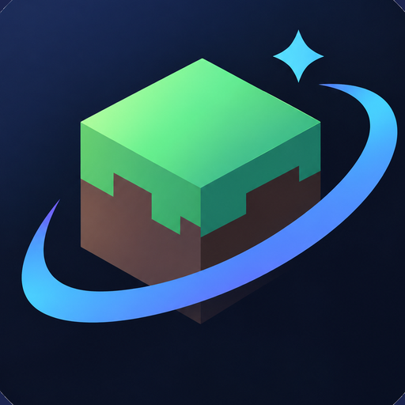

<a href="../../README_EN.md">English</a> · <a href="../../README.md">简体中文</a> · <a href="../zh-Hant/README.md">繁體中文</a> · <a href="../ja/README.md">日本語</a> · <a href="../ko/README.md">한국어</a> · <a href="../tr/README.md">Türkçe</a> · <a href="../ru/README.md">Русский</a> · <a href="../vi/README.md">Tiếng Việt</a> · <a href="../th/README.md">ไทย</a> · <a href="../de/README.md">Deutsch</a> · <a href="../es/README.md">Español</a> · <a href="../fr/README.md">Français</a>
 
<a href="../uk/README.md">Українська</a> · <a href="../pl/README.md">Polski</a> · <a href="../pt-BR/README.md">Português (Brasil)</a> · <a href="../ar/README.md">العربية</a> · <a href="../fa/README.md">فارسی</a> · <a href="../id/README.md">Bahasa Indonesia</a> · <a href="../it/README.md">Italiano</a> · <b>Ελληνικά</b> · <a href="../ml/README.md">മലയാളം</a> · <a href="../ur-Latn/README.md">Roman Urdu</a> · <a href="../ro/README.md">Română</a> · <a href="../bg/README.md">Български</a>

  

# ZyNova

> ⭐ **Κυκλοφόρησε το ZyNova 28.1.0 (έκδοση με παγκόσμια συμμόρφωση).**

---

Ένας launcher για **Minecraft: Java Edition** σε Android, που συντηρείται και δημοσιεύεται ανεξάρτητα με βάση τον κώδικα του ZalithLauncher2. Δεν είναι επίσημη έκδοση.

Στόχος: **λιγότερα πατήματα**. Ό,τι μπορεί να αυτοματοποιηθεί — εγκατάσταση παιχνιδιού, συγκέντρωση mods και modpacks, αλλαγή ρυθμίσεων, ανάγνωση logs — το αναλαμβάνει ο πράκτορας AI.

- GitHub：<https://github.com/zzy89216-gif/ZyNova>
- Σφάλματα και προτάσεις：<https://github.com/zzy89216-gif/ZyNova/issues>
- Discord：<https://discord.gg/QwPpZQHrTa>
- X (επίσημος κύριος λογαριασμός)：<https://x.com/ZyNovaProject>
- Γραμματοκιβώτιο κινεζικού οικοσυστήματος：<ZyNovaLauncher@163.com>
- Παγκόσμιο γραμματοκιβώτιο：<ZyNovaLauncher@outlook.com>

## ✨ Τι νέο στην 28.1.0

- **Ροή συμμόρφωσης στην πρώτη εκκίνηση**：τρία ενοποιημένα έγγραφα — ① EULA + πολιτική απορρήτου, ② ειδοποίηση ανοιχτού κώδικα τρίτων + αποποιήσεις ευθύνης και κίνδυνοι, ③ οδηγός χρήσης + περιοχές ισχύος και δικαιοδοσία. Κάθε έγγραφο πρέπει να **κυληθεί ως το τέλος και να επιβεβαιωθεί χωριστά**· μετά επιλέγετε ηλικιακή ομάδα (και οι υπάρχοντες χρήστες το βλέπουν μία φορά μετά την ενημέρωση).
- **Χρονικό παράθυρο για ανηλίκους**：κάτω των 18 ετών το παιχνίδι ξεκινά μόνο Παρασκευή, Σάββατο, Κυριακή και σε επίσημες αργίες, **20:00–21:00**. Οι αργίες του 2026 ακολουθούν το ημερολόγιο του Κρατικού Συμβουλίου της Κίνας (国办发明电〔2025〕7号)· οι ημέρες αναπλήρωσης εργασίας μετράνε ως εργάσιμες.
- **Οι αποποιήσεις γράφτηκαν αναλυτικά**：απώλεια save, υπερθέρμανση συσκευής, αποκλεισμός από τρίτους, διακοπή υπηρεσίας και παρόμοιοι κίνδυνοι δηλώνονται ρητά.
- **Επίσης**：η αρχική οθόνη δεν κολλάει πλέον στη φόρτωση, η αναζήτηση ιστού της AI λειτουργεί, η εισαγωγή πηγαίνει στον φάκελο instance και αφαιρέθηκε η αυτόματη επιδιόρθωση μετά από crash.

## 🛠️ Τι κάνει

- **Πράκτορας AI**：DeepSeek προεπιλογή — εγκαθιστά παιχνίδι, modpacks και mods, αλλάζει ρυθμίσεις, διαβάζει logs, εκκινεί το παιχνίδι
- **Renderers**：Αυτόματο / MobileGlues / GL4ES / LTW (πειραματικό)
- **Πυρήνας πόρων**：αναζήτηση Modrinth / CurseForge, επίλυση εξαρτήσεων, λήψη, επαλήθευση, εγκατάσταση
- **Αγαπημένα και αρχείο**：διαδικτυακά αγαπημένα + ιδιωτικό αρχείο, αφαίρεση διπλότυπων με SHA-256
- **Προστασία Fabric API**：Fabric API / Quilted Fabric API / Legacy Fabric API προστίθενται από τη ροή εγκατάστασης — δεν διπλασιάζονται, δεν αναζητούνται, δεν διαγράφονται

## 📦 Λήψη και build

- Λήψη：<https://github.com/zzy89216-gif/ZyNova/releases> (πάντα την τελευταία έκδοση)
- Δικό σας build：JDK 17 + Android SDK / NDK, μετά `./gradlew ZalithLauncher:assembleRelease`
- Σημείωση：στην πρώτη εκκίνηση εμφανίζεται η ροή συμμόρφωσης· λεπτομέρειες για περιοχές και όρια ηλικίας στο [docs/en/licenses.md](../../docs/en/licenses.md).

## 📚 Τεκμηρίωση

> 📚 Η τεκμηρίωση υπάρχει προς το παρόν στα κινεζικά και τα αγγλικά (70+ άρθρα)· αυτή η σελίδα είναι η ελληνική εισαγωγή.

| Περιεχόμενο | Αρχείο |
|---|---|
| Ευρετήριο τεκμηρίωσης | [docs/en/README.md](../../docs/en/README.md) |
| Εγκατάσταση / χρήση / εξαγωγή | [docs/en/install.md](../../docs/en/install.md) · [docs/en/usage.md](../../docs/en/usage.md) |
| Rendering / σύνδεση / αγαπημένα / AI | [docs/en/renderers.md](../../docs/en/renderers.md) · [docs/en/login.md](../../docs/en/login.md) · [docs/en/favorites.md](../../docs/en/favorites.md) · [docs/en/ai-agent.md](../../docs/en/ai-agent.md) |
| Αντιμετώπιση προβλημάτων / FAQ / δεδομένα και απόρρητο | [docs/en/troubleshooting.md](../../docs/en/troubleshooting.md) · [docs/en/faq.md](../../docs/en/faq.md) · [docs/en/data-and-privacy.md](../../docs/en/data-and-privacy.md) |
| Build | [docs/en/build.md](../../docs/en/build.md) |
| Αλλαγές | [CHANGELOG.md](../../CHANGELOG.md) |
| Παράδοση / αρχιτεκτονική / ροή εργασίας | [HANDOFF.md](../../HANDOFF.md) |
| Είσοδος για όποιον αναλαμβάνει (κατάσταση / release / παγίδες / κανόνες τεκμηρίωσης) | [AGENTS.md](../../AGENTS.md) |
| Άδειες τρίτων | [THIRD_PARTY_NOTICES.md](../../THIRD_PARTY_NOTICES.md) |
| Άδεια | [LICENSE](../../LICENSE) |

## 💖 Υποστήριξη

- Αναφορά προβλήματος：<https://github.com/zzy89216-gif/ZyNova/issues>
- Discord：<https://discord.gg/QwPpZQHrTa>
- Email：παγκόσμια <ZyNovaLauncher@outlook.com> ｜ Κίνα <ZyNovaLauncher@163.com>
- Επίσημο X：<https://x.com/ZyNovaProject>
- Στηρίξτε το έργο：<https://afdian.com/a/hizzy>

## ⚖️ Άδεια

GPL-3.0 — το έργο παραμένει ανοιχτού κώδικα. Τα στοιχεία τρίτων και οι άδειές τους αναφέρονται στα
[THIRD_PARTY_NOTICES.md](../../THIRD_PARTY_NOTICES.md) και [docs/en/licenses.md](../../docs/en/licenses.md).

> ⚠️ **Το Terracotta (multiplayer) είναι υπό AGPL-3.0**, αυστηρότερη από τα υπόλοιπα: διανέμεται χωρίς
> αλλαγές. Αν το τροποποιήσετε και το διανείμετε ξανά, το §13 της AGPL-3.0 σας υποχρεώνει να
> δημοσιεύσετε τον αντίστοιχο πηγαίο κώδικα.

---

**ZyNova — Context First. Less Steps.**
